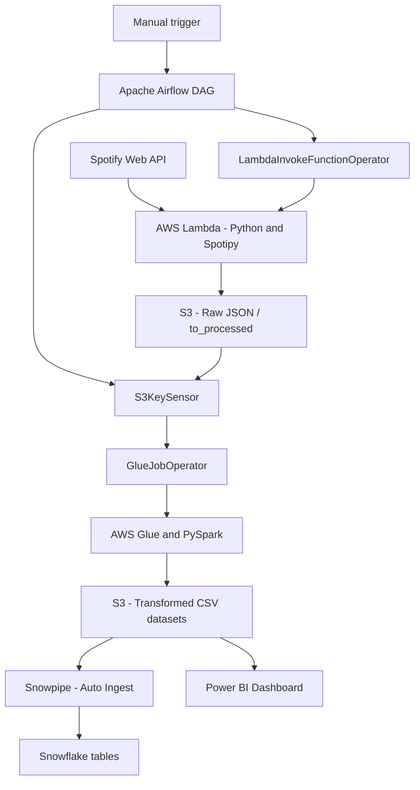
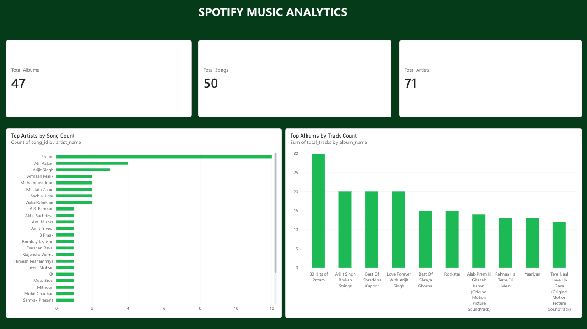

# Spotify ETL Pipeline Orchestration with Apache Airflow

An end-to-end Spotify playlist data engineering project that orchestrates extraction and transformation on AWS, prepares analytics-ready song, album and artist datasets, loads those datasets into Snowflake with Snowpipe, and presents music-catalogue insights through Power BI.

<p align="left">
  
  
  
  
  
  
  
</p>

## Project Overview

The pipeline extracts playlist data from the Spotify Web API, stores the raw response in Amazon S3, and uses Apache Airflow to coordinate the AWS processing workflow. AWS Glue and PySpark flatten the nested JSON response into three structured datasets: songs, albums and artists. The transformed CSV outputs are stored in S3 and ingested into Snowflake through Snowpipe. A Power BI report presents summary metrics and catalogue analysis across the same three datasets.

The Airflow orchestration layer is the focus of this repository: it connects the extraction Lambda, S3 file readiness check and existing Glue transformation job into one manually triggered DAG.

## Architecture



**Reporting data path:** Power BI uses consolidated exports of the transformed S3 datasets. Those are the same song, album and artist data outputs ingested into Snowflake. The Power BI report file is included for review; the report's imported data is a saved snapshot rather than a live DirectQuery connection.

## Workflow

### 1. Extract — Spotify API and AWS Lambda

- Uses Python and Spotipy to authenticate to Spotify and retrieve playlist items.
- Reads Spotify OAuth values from Lambda environment variables (`client_id`, `client_secret`, `refresh_token`).
- Writes the raw JSON response to the S3 `raw_data/to_processed/` prefix.
- The current extraction implementation requests the first 50 playlist items per invocation (`limit=50`, `offset=0`); pagination is not implemented in this version.

### 2. Orchestrate — Apache Airflow

The DAG is defined in `dags/spotify_airflow_pipeline.py` with the ID `spotify_airflow_pipeline`.

It executes these tasks in order:

1. `trigger_extract_lambda` — invokes the deployed `spotify_api_data_extract` Lambda function.
2. `wait_for_raw_files` — uses `S3KeySensor` to wait for objects matching `raw_data/to_processed/*`.
3. `run_glue_transformation` — starts the existing `spotify_transformation_job` Glue job and waits for completion.

The DAG is manually triggered (`schedule=None`), uses `catchup=False`, and allows one active run at a time (`max_active_runs=1`). The S3 sensor checks for any matching object under the configured prefix; it does not correlate the detected object to a particular DAG run.

### 3. Transform — AWS Glue and PySpark

The Glue script reads raw JSON from S3 into a Glue DynamicFrame and converts it to a Spark DataFrame. It uses `explode`, column selection and deduplication to produce:

| Dataset | Main fields |
|---|---|
| Songs | `song_id`, `song_name`, `duration_ms`, `url`, `added_at`, `album_id`, `artist_id` |
| Albums | `album_id`, `album_name`, `release_date`, `total_tracks`, `url` |
| Artists | `artist_id`, `artist_name`, `artist_url` |

The three datasets are written as CSV output under date-stamped S3 prefixes:

- `transformed_data/song_data/`
- `transformed_data/album_data/`
- `transformed_data/artist_data/`

Spark writes each dataset as one or more `part` files inside its output folder. This is expected distributed-write behavior. The Glue script then copies the raw JSON objects to `raw_data/processed/` and deletes the originals from `raw_data/to_processed/` after each copy succeeds.

### 4. Warehouse — Snowpipe and Snowflake

Snowpipe auto-ingest is configured for the transformed song, album and artist outputs. The corresponding Snowflake tables are:

- `SPOTIFY_MUSIC_DB.PUBLIC.TBLSONGS`
- `SPOTIFY_MUSIC_DB.PUBLIC.TBLALBUM`
- `SPOTIFY_MUSIC_DB.PUBLIC.TBLARTIST`

### 5. Analytics — Power BI

The Power BI report, `Spotify Music Analytics`, contains:

- KPI cards for total songs, albums and artists.
- Artist-wise song count analysis.
- Top albums by total track count.

The dashboard snapshot shown below reflects the imported dataset used to build the report (50 songs, 47 albums and 71 artists).

## Power BI Dashboard



**Power BI report file:** `powerbi/Spotify_Music_Analytics.pbix`

Place the PBIX file you downloaded from Power BI Service in the `powerbi/` directory using the exact filename above. The screenshot is included as a quick preview in the GitHub README.

## Technology Stack

| Area | Technology | Purpose |
|---|---|---|
| Data source | Spotify Web API, Spotipy | Playlist metadata extraction |
| Extraction | Python, AWS Lambda | Retrieve data and land raw JSON |
| Storage | Amazon S3 | Raw, staged, archived and transformed data |
| Orchestration | Apache Airflow 2.9.1 | Coordinate Lambda, S3 sensor and Glue tasks |
| Transformation | AWS Glue, PySpark | Flatten nested JSON and create structured datasets |
| Warehouse ingestion | Snowpipe | Auto-ingest transformed files |
| Data warehouse | Snowflake | Store song, album and artist tables |
| Dashboard | Microsoft Power BI | Explore music catalogue metrics |
| Local environment | Docker Compose | Run Airflow locally |

## Repository Structure

```text
spotify-etl-airflow-orchestration/
├── dags/
│   └── spotify_airflow_pipeline.py
├── powerbi/
│   ├── Spotify_Music_Analytics.pbix
│   └── dashboard-preview.png
├── data_extraction.py
├── data_transformation.py
├── docker-compose.yaml
├── .gitignore
└── README.md
```

## Run the Airflow Environment Locally

### Prerequisites

- Docker Desktop with Docker Compose
- Access to the AWS Lambda function, S3 bucket and Glue job referenced in the DAG
- An AWS identity with the permissions required by the Airflow tasks
- An Airflow connection named `aws_default`
- Spotify OAuth credentials configured as environment variables in the deployed Lambda function

### 1. Clone the repository

```bash
git clone https://github.com/GauravAmbasta2405/spotify-etl-airflow-orchestration.git
cd spotify-etl-airflow-orchestration
```

### 2. Start Airflow

```bash
docker compose up -d
```

The Compose file uses the Apache Airflow `2.9.1` image, the `standalone` command, `SequentialExecutor`, and the Amazon provider package. Open the Airflow UI at `http://localhost:8080` and sign in with the credentials created by the local Airflow standalone setup.

### 3. Configure the AWS connection

In the Airflow UI, create or configure a connection with:

| Field | Value |
|---|---|
| Connection ID | `aws_default` |
| Connection Type | Amazon Web Services |
| Region | `us-east-1` |

Provide AWS credentials using the Airflow connection or an appropriate IAM-based credential mechanism. Do not commit credentials to this repository.

### 4. Verify AWS configuration and trigger the DAG

Before triggering the DAG, ensure the Lambda function, S3 bucket/prefixes, Glue job, Glue script location and Glue IAM role match the values in `dags/spotify_airflow_pipeline.py` and exist in your AWS account. Then trigger `spotify_airflow_pipeline` from the Airflow UI.

> **Cost note:** A DAG run invokes AWS Lambda and starts an AWS Glue job after the S3 sensor succeeds. AWS Glue can incur charges while running. Only trigger the workflow when needed and review active AWS resources after testing.

## Configuration Reference

The current DAG references the following AWS resources:

| Setting | Configured value |
|---|---|
| AWS region | `us-east-1` |
| Airflow connection | `aws_default` |
| Lambda function | `spotify_api_data_extract` |
| S3 bucket | `spotify-etl-project-gaurav-ambasta` |
| Raw prefix | `raw_data/to_processed/` |
| Glue job | `spotify_transformation_job` |
| Glue script | `s3://aws-glue-assets-206986907456-us-east-1/scripts/spotify_transformation_job.py` |
| Glue IAM role | `spotify_glue_iam_role` |

Update these values if deploying the project into a different AWS account or region.

## Implementation Notes

- The DAG is manually triggered; it is not configured for a recurring schedule.
- The S3 sensor checks for any object matching the staging prefix, rather than a run-specific object key.
- The current Lambda implementation retrieves at most 50 playlist items per invocation.
- Glue writes Spark CSV part files to date-stamped S3 folders; the output is not a single named CSV object.
- The Glue archival code copies raw JSON files to the processed prefix and deletes each original only after the copy operation succeeds.
- The Power BI report uses an imported snapshot of the transformed datasets, not a live DirectQuery connection to Snowflake.

## Security

- Never commit Spotify client secrets, refresh tokens, AWS access keys, private keys or local `.env` files.
- Keep credentials in Lambda environment variables, Airflow connections or IAM roles.
- The repository `.gitignore` excludes common Python/Airflow runtime files and local credential files.

---

<p align="center">Built as a hands-on project in cloud data engineering and workflow orchestration.</p>
