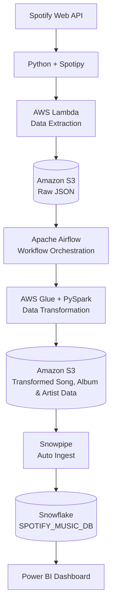
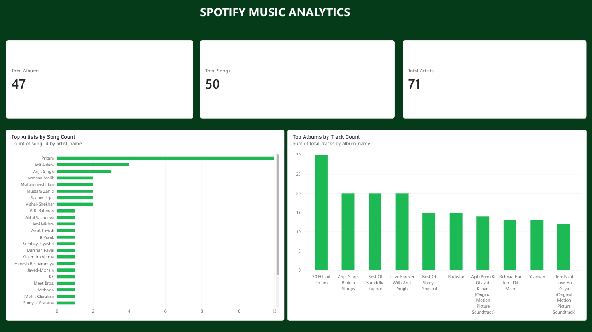

# 🎧 Spotify ETL Pipeline — Apache Airflow Orchestration

An end-to-end Spotify data engineering project that uses **Apache Airflow** to orchestrate data extraction and transformation across AWS services. Spotify playlist data is extracted with Python and Spotipy, stored in Amazon S3, transformed with AWS Glue and PySpark, loaded into Snowflake through Snowpipe, and presented through a Power BI dashboard.

## 🏗️ Architecture



## 📌 Project Overview

This project extends the Spotify data pipeline by introducing Apache Airflow to coordinate the extraction and transformation workflow.

The pipeline processes Spotify playlist data into three datasets:

- 🎵 **Songs:** Song ID, name, duration, Spotify URL, added date, album ID and artist ID.
- 💿 **Albums:** Album ID, name, release date, total tracks and Spotify URL.
- 🎤 **Artists:** Artist ID, name and Spotify URL.

## ⚙️ Pipeline Workflow

### 1. Extract — Spotify API to Amazon S3

**File:** `data_extraction.py`

- Uses Python and Spotipy to authenticate with Spotify and retrieve playlist data.
- Runs as an AWS Lambda function named `spotify_api_data_extract`.
- Stores the raw Spotify API response as JSON in Amazon S3.

Raw data location:

```text
s3://spotify-etl-project-gaurav-ambasta/raw_data/to_processed/
```

### 2. Orchestrate — Apache Airflow

**File:** `dags/spotify_airflow_pipeline.py`

The `spotify_airflow_pipeline` DAG coordinates the AWS extraction and transformation tasks in the required order.

| Airflow task | Operator / Sensor | Responsibility |
|---|---|---|
| `trigger_extract_lambda` | `LambdaInvokeFunctionOperator` | Invokes the Spotify extraction Lambda. |
| `wait_for_raw_files` | `S3KeySensor` | Waits for raw JSON files in the configured S3 prefix. |
| `run_glue_transformation` | `GlueJobOperator` | Starts the AWS Glue transformation job and waits for completion. |

Task dependency:

```text
trigger_extract_lambda >> wait_for_raw_files >> run_glue_transformation
```

Airflow manages task dependencies and execution, while Lambda handles extraction and Glue performs the data transformation.

### 3. Transform — AWS Glue and PySpark

**File:** `data_transformation.py`

AWS Glue reads the raw JSON files from S3 and uses PySpark to process the nested Spotify response.

The transformation creates three separate datasets:

| Dataset | Transformation |
|---|---|
| Songs | Extracts song metadata, duration, added date, album ID and artist ID; removes duplicate song IDs. |
| Albums | Extracts album metadata, release date and track count; removes duplicate album IDs. |
| Artists | Expands the nested artists array and extracts artist details; removes duplicate artist IDs. |

The transformed datasets are written as CSV output to date-stamped S3 locations:

```text
transformed_data/
├── song_data/
├── album_data/
└── artist_data/
```

After transformation, the raw JSON objects are copied to `raw_data/processed/` and removed from `raw_data/to_processed/` after the copy succeeds.

### 4. Load — Snowpipe and Snowflake

Snowpipe is configured with auto-ingest to load the transformed song, album and artist data into Snowflake.

**Database:** `SPOTIFY_MUSIC_DB`  
**Schema:** `PUBLIC`

| Snowflake table | Data |
|---|---|
| `TBLSONGS` | Song-level records |
| `TBLALBUM` | Album metadata |
| `TBLARTIST` | Artist information |

### 5. Visualize — Power BI

The Spotify Music Analytics dashboard presents the song, album and artist datasets through:

- Total Songs, Total Albums and Total Artists KPI cards.
- Top Artists by Song Count.
- Top Albums by Track Count.



Power BI project file: [`Spotify_Music_Analytics.pbix`](powerbi/Spotify_Music_Analytics.pbix)

## 🛠️ Technology Stack

| Area | Technologies |
|---|---|
| Data source | Spotify Web API, Spotipy |
| Programming | Python |
| Extraction | AWS Lambda |
| Storage | Amazon S3 |
| Orchestration | Apache Airflow 2.9.1 |
| Transformation | AWS Glue, PySpark |
| Data ingestion | Snowpipe (auto-ingest) |
| Data warehouse | Snowflake |
| Dashboard | Microsoft Power BI |
| Local environment | Docker Compose |

## 📁 Repository Structure

```text
spotify-etl-airflow-orchestration/
├── dags/
│   └── spotify_airflow_pipeline.py
├── powerbi/
│   ├── Spotify_Music_Analytics.pbix
│   └── dashboard-preview.png
├── data_extraction.py
├── data_transformation.py
├── docker-compose.yaml
├── .gitignore
└── README.md
```

## 🚀 Run Airflow Locally

### Prerequisites

- Docker Desktop
- AWS resources used by the DAG: Lambda, S3 and AWS Glue
- Spotify Developer credentials configured for the extraction Lambda

### Start Airflow

From the repository root, run:

```bash
docker compose up -d
```

Open the Airflow interface at:

```text
http://localhost:8080
```

Configure the Airflow AWS connection with the connection ID `aws_default` and the AWS access required by the DAG. The DAG references AWS region `us-east-1`, the S3 bucket `spotify-etl-project-gaurav-ambasta`, the Lambda function `spotify_api_data_extract`, and the Glue job `spotify_transformation_job`.

## 👨‍💻 Author

**Gaurav Ambasta**

- GitHub: [GauravAmbasta2405](https://github.com/GauravAmbasta2405)
- LinkedIn: [gaurav-ambasta](https://www.linkedin.com/in/gaurav-ambasta/)
